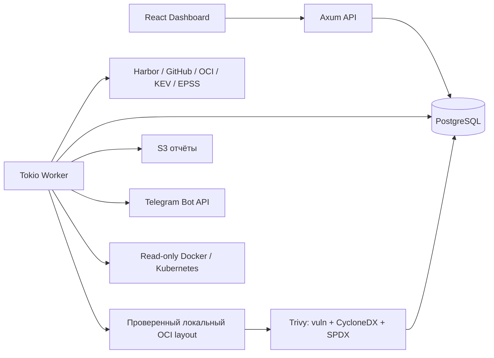

# Архитектура

Один Rust workspace, два процесса, одна PostgreSQL БД. API отдаёт REST и SPA.
Worker планирует задания и исполняет адаптеры; API не выполняет Trivy.
Интеграции сгруппированы в crate integrations; core содержит чистые правила.

Таблицы хранят пользователей/сессии, проекты/источники, repositories, images,
image_versions, deployments, scan_runs, sbom_artifacts, vulnerabilities,
vulnerability_findings, vulnerability_status_history, update_recommendations,
version_approvals, notification_rules, notifications, jobs, audit_logs, integrations.
UUID создаются в приложении, поэтому расширения PostgreSQL не нужны.
Уникальность finding: scan+CVE+package+installed+target. Новый scan не удаляет старые.
Актуальный Dashboard читает последний COMPLETED scan каждого образа.

Очередь использует одну атомарную CTE UPDATE с FOR UPDATE SKIP LOCKED.
Lease 90 секунд, heartbeat каждые 25 секунд, новый lease_token при claim.
Completion требует совпадения lease token. Retry с ограниченным exponential backoff;
после max_attempts запись FAILED. Нормальный повтор Telegram dedup по event_key.
Delivery семантика — at least once, внешняя exactly once не гарантируется.

Сканирование: приложение скачивает manifest/blobs только проверенным HTTP transport,
не следует foreign layer URLs, проверяет SHA-256 и размеры. Из index выбирается
linux/SCAN_ARCHITECTURE. Формируется OCI layout. Trivy читает локальный OCI directory,
не получает окружение приложения и registry credentials; свою CVE DB он получает
с upstream Trivy. Установки образов в Docker Engine нет.

HTTP transport проверяет все DNS-адреса, закрепляет их в rustls/reqwest клиенте,
отключает proxy из окружения и автоматические redirects. Blob CDN redirect до
трёх переходов проверяется отдельно; Authorization не передаётся CDN.
Явно заданные Harbor/S3/Discovery могут использовать внутренние адреса,
metadata/loopback/link-local всё равно запрещены.

Ограничения текущей модели: схема scan/documents хранит JSON также в PostgreSQL
для доступности без S3; политики retention/GC отсутствуют. Распределённая квота
параллелизма между несколькими Worker не реализована — запускать один экземпляр.

Контракт локального OCI input сверялся с официальными источниками:
[Trivy container image](https://github.com/aquasecurity/trivy/blob/main/docs/guide/target/container_image.md),
[OCI input implementation](https://github.com/aquasecurity/trivy/blob/main/pkg/fanal/image/oci.go).
--offline-scan отключает API-запросы идентификации зависимостей, но не обновление
самой vulnerability DB. Полнота определения пакетов зависит от содержимого image.
